<div align="center">

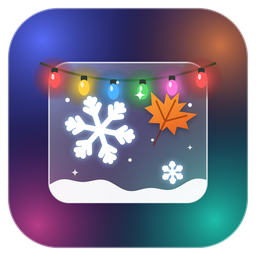

# Seasonal Overlay

**Snow, falling leaves, string lights and fireworks over your Home Assistant dashboards.**

[](https://hacs.xyz/docs/faq/custom_repositories)
[](https://www.home-assistant.io/)
[](https://github.com/Degederon/SeasonalOverlay/blob/main/CHANGELOG.md)
[](#languages)
[](https://github.com/Degederon/SeasonalOverlay/blob/main/LICENSE)

</div>

Beautiful design and ease of use. https://github.com/Degederon/SeasonalOverlay

Seasonal Overlay decorates your dashboards for the time of year: a border of snowdrifts and icicles in winter, blinking string lights in December, cobwebs and glowing pumpkins at Halloween, and falling snow, drifting leaves, petals, fireflies or fireworks across the screen. It follows the calendar by itself, so a wall tablet changes with the seasons without you touching it. Every tap still reaches your cards underneath.

**Languages:** English, German (Deutsch), Spanish (Español) and French (Français). Setup, controls and theme names follow your Home Assistant language.

<p align="center">
  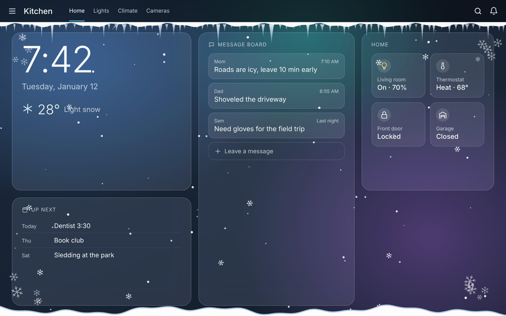
</p>

> **Tip:** it pairs beautifully with [Glass Message Board](https://github.com/Degederon/GlassMessageBoard) and the other Glass cards. Frosted panels over drifting snow is the look it was designed around.

## Contents

- [Features](#features)
- [Take a tour](#take-a-tour)
- [Requirements](#requirements)
- [Step-by-step setup](#step-by-step-setup)
- [The controls](#the-controls)
- [Themes and the calendar](#themes-and-the-calendar)
- [Automation ideas](#automation-ideas)
- [Only on some dashboards](#only-on-some-dashboards)
- [Using it outside Home Assistant](#using-it-outside-home-assistant)
- [Moving from the hand-installed version](#moving-from-the-hand-installed-version)
- [Languages](#languages)
- [Troubleshooting](#troubleshooting)
- [Contributing](#contributing)
- [License](#license)

## Features

| Feature | Description |
|---|---|
| **11 themes** | Winter, Holiday lights, New Year's, Valentine's Day, Spring, Summer (day and night), Fourth of July, Fall, Halloween and Rainy day. |
| **Follows the calendar** | On **Automatic**, the theme changes by date, and holidays win over seasons. |
| **Border, falling or both** | A decorated frame around the screen, effects drifting across it, or both together. |
| **Every dashboard, no card** | It loads by itself on all your dashboards. Nothing to add to a dashboard and nothing to add under resources. |
| **Controls in Home Assistant** | An on/off switch, theme, mode and density, so dashboards and automations can change them. |
| **Follows the weather** | Optional: real rain or snow outside replaces the seasonal theme. Holidays stay. |
| **Day and night** | The summer theme shows the sun and ocean waves by day, the moon, stars and fireflies after sunset. |
| **Taps go through** | The decorations sit on top but never block a tap. |
| **Gets out of the way** | Move the mouse into a corner and the decorations there fade away, so you can reach the sidebar menu. A soft clear spot also follows the mouse. Touch screens are unaffected. |
| **Leaves the header clear** | Decorations start below the Home Assistant header, adjustable for kiosk setups. |
| **Off on chosen devices** | Keep it on the wall tablet and off your phone. |
| **Tablet friendly** | Capped frame rate, pauses when the screen is off, nothing running when switched off, and honours reduced motion. |
| **Four languages** | English, German, Spanish and French: setup, controls and theme names follow your Home Assistant language. |
| **Lightweight** | One small script with no dependencies, drawn in code. No images to download. |

## Take a tour

All pictures are of the overlay itself, over a sample wall-tablet dashboard. The wallpaper and glass cards belong to the sample dashboard.

<table>
<tr>
<td width="50%" valign="top"><br><sub><b>Winter.</b> A snow cap with dripping icicles, a snowdrift, frosty corner flakes and falling snow.</sub></td>
<td width="50%" valign="top">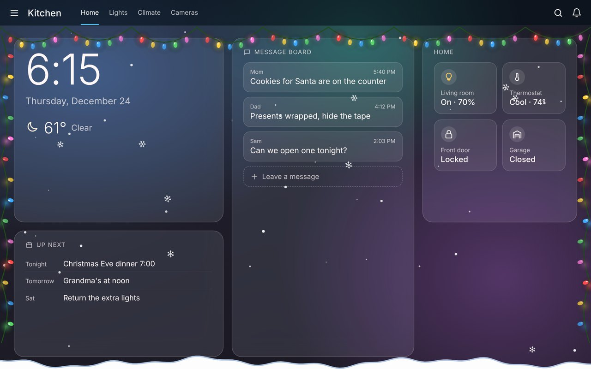<br><sub><b>Holiday lights.</b> Blinking string lights along the top and sides, with gentle snow.</sub></td>
</tr>
<tr>
<td width="50%" valign="top">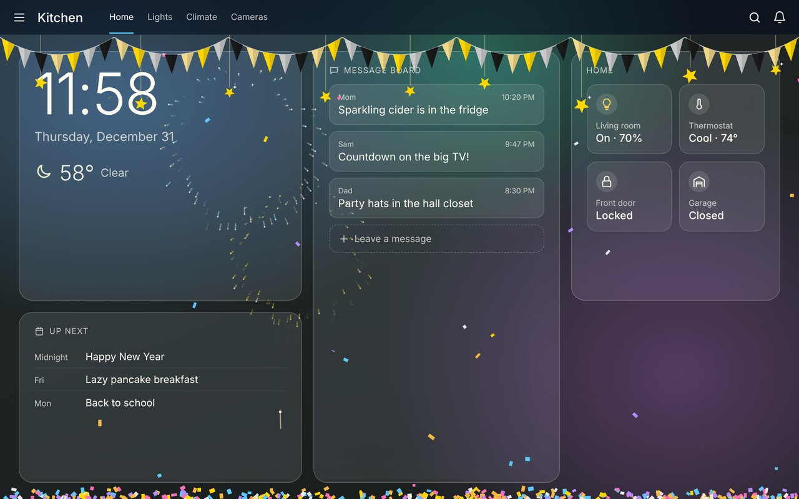<br><sub><b>New Year's.</b> Gold and silver bunting, hanging stars, confetti and fireworks.</sub></td>
<td width="50%" valign="top">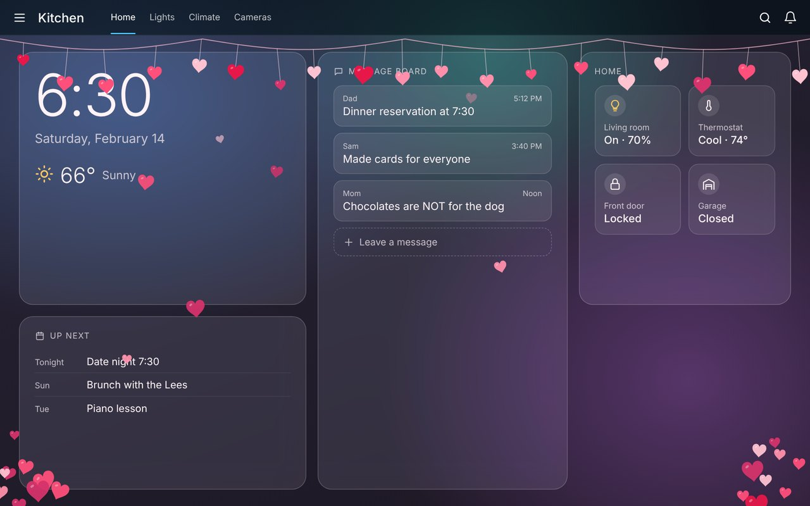<br><sub><b>Valentine's Day.</b> Hearts swaying on strings, with more rising from below.</sub></td>
</tr>
<tr>
<td width="50%" valign="top">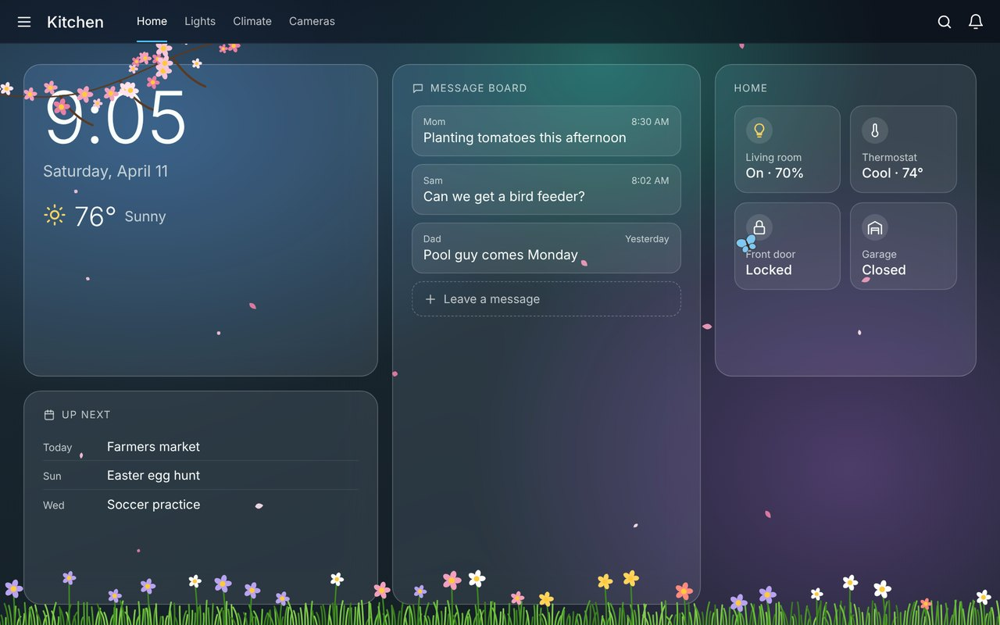<br><sub><b>Spring.</b> A cherry blossom branch, flowers in the grass, drifting petals and butterflies.</sub></td>
<td width="50%" valign="top">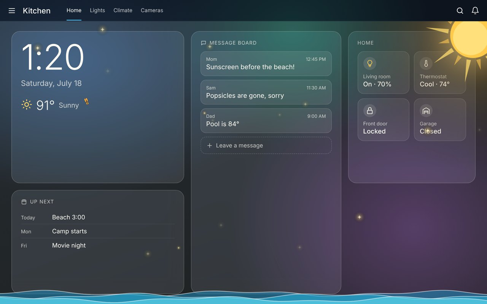<br><sub><b>Summer, day.</b> A warm sun in the corner, rolling ocean waves and floating light.</sub></td>
</tr>
<tr>
<td width="50%" valign="top">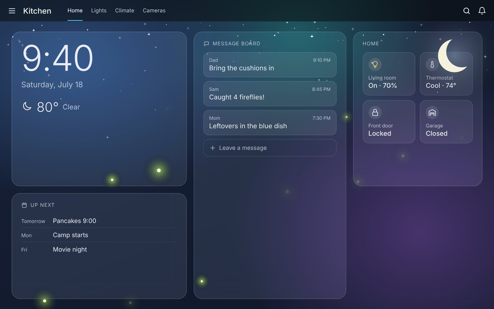<br><sub><b>Summer, night.</b> After sunset: the moon, twinkling stars and fireflies.</sub></td>
<td width="50%" valign="top">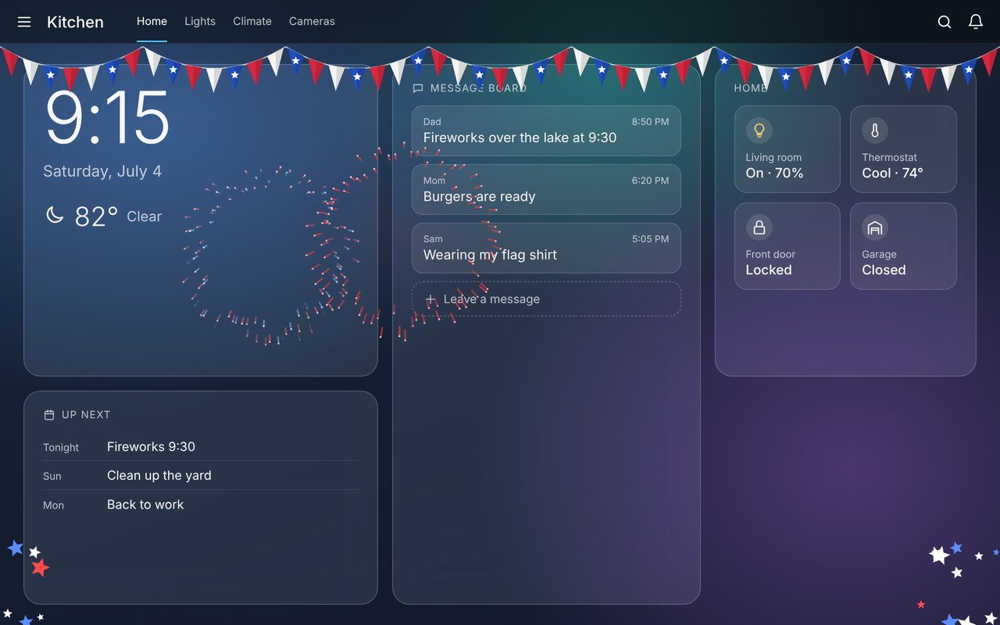<br><sub><b>Fourth of July.</b> Red, white and blue bunting with fireworks bursting overhead.</sub></td>
</tr>
<tr>
<td width="50%" valign="top">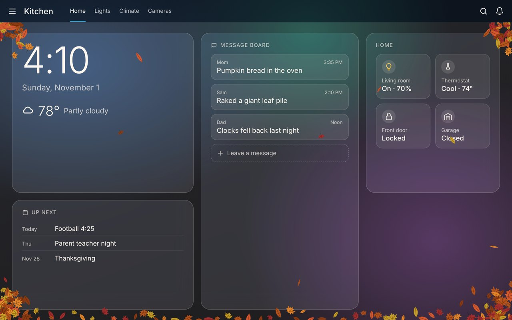<br><sub><b>Fall.</b> Maple leaves piled in the corners, with a few tumbling down.</sub></td>
<td width="50%" valign="top">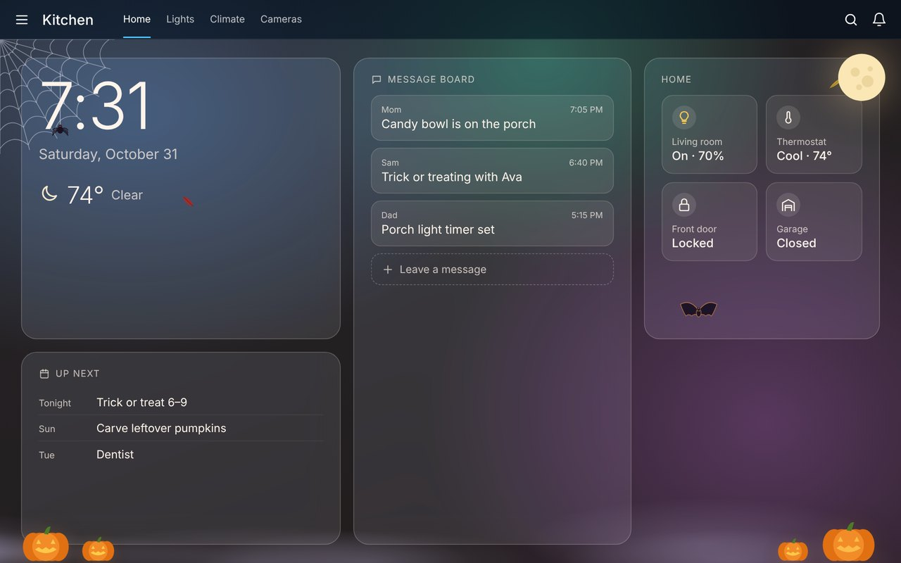<br><sub><b>Halloween.</b> A cobweb with a dangling spider, the moon, flickering pumpkins, fog and bats.</sub></td>
</tr>
<tr>
<td width="50%" valign="top">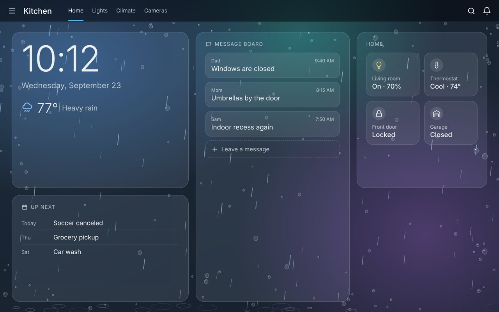<br><sub><b>Rainy day.</b> Drops on the glass and rain with puddle ripples. Appears by itself when it rains, if you turn on Follow the weather.</sub></td>
<td width="50%" valign="top">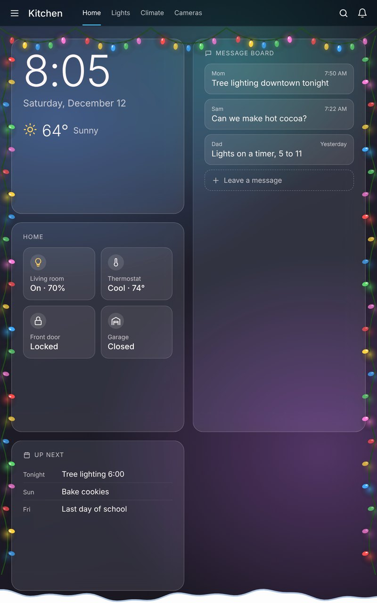<br><sub><b>Border only, portrait.</b> Just the frame, nothing moving, on an upright tablet.</sub></td>
</tr>
</table>

## Requirements

- Home Assistant **2024.11** or later. On **2026.11** and later, install through the built-in **Marketplace**; on earlier versions, use **HACS**.
- The app icon in the Marketplace and on **Devices & services** needs Home Assistant **2026.3** or later. Everything else works without it.
- For **Follow the weather**: any `weather` entity, such as the built-in forecast.

## Step-by-step setup

Follow these parts in order. Parts 1 to 3 only need doing once.

Seasonal Overlay installs as an **integration**: a small add-on that delivers the overlay to your dashboards and keeps it up to date. You don't need to add a card or anything under dashboard resources.

### Part 1: Install Seasonal Overlay

**Using the Marketplace (Home Assistant 2026.11 and later)**

1. Go to **Settings → Marketplace**.
2. The first time, read the community-content warning and confirm.
3. Choose **Add via link**.
4. Paste `https://github.com/Degederon/SeasonalOverlay` into **GitHub link**.
5. Set **Type** to **Integration**, then select **Add**.
6. Open **Seasonal Overlay** and select **Install**.
7. Restart Home Assistant: go to **Settings → System**, select the power icon in the top right, then **Restart Home Assistant**.

**Using HACS (earlier versions)**

1. Open **HACS**, select the menu (⋮) in the top right, and choose **Custom repositories**.
2. Paste `https://github.com/Degederon/SeasonalOverlay` into **Repository**.
3. Set **Type** (or **Category**) to **Integration**, then select **Add**.
4. Close the dialog, search HACS for **Seasonal Overlay**, open it and select **Download**.
5. Restart Home Assistant, as above.

**Manual installation**

1. Download this repository as a ZIP: on [the repository page](https://github.com/Degederon/SeasonalOverlay), select **Code → Download ZIP**, and unzip it.
2. Copy the `custom_components/seasonal_overlay` folder into the `custom_components` folder inside your Home Assistant `config` folder. Create `custom_components` if it doesn't exist.
3. Restart Home Assistant.

> **Already added `seasonal-overlay-card.js` by hand?** See [Moving from the hand-installed version](#moving-from-the-hand-installed-version) first.

### Part 2: Turn on the integration

Installing downloads the files; adding the integration switches it on.

1. Go to **Settings → Devices & services**.
2. Select **+ Add integration** (bottom right).
3. Search for **Seasonal Overlay**, select it, then select **Submit**.

To check it worked: **Seasonal Overlay** is listed on the **Devices & services** page, with its icon, and has one device with six controls.

### Part 3: Refresh the page

Your browser has to load the overlay once. After installing, and after every update:

- **Computer:** press **Ctrl + Shift + R** (Mac: **Cmd + Shift + R**) on any Home Assistant page.
- **Companion app (phone or tablet):** go to **Settings → Companion app → Debugging → Reset frontend cache**, then close and reopen the app.
- **Kiosk browser on a wall tablet** (such as Fully Kiosk Browser): clear its cache and reload the page.

To check it worked: open any dashboard. You should see this season's decorations. In November that's fall leaves.

### Part 4: Choose a look (optional)

Open **Settings → Devices & services → Seasonal Overlay → Seasonal Overlay** (the device). Its controls change every screen at once:

- **Theme:** leave it on **Automatic** to follow the calendar, or pick one.
- **Mode:** **Border and falling**, **Border only** or **Falling only**.
- **Density:** 1 is a few flakes, 10 is a blizzard. Borders don't change.

Select **Add to dashboard** on the device page to put these controls on a dashboard.

### Part 5: Keep it off some devices (optional)

The overlay shows on every device that opens your dashboards. To turn it off on one device only, such as your phone:

1. On that device, open Home Assistant in its browser.
2. Add `?seasonal_overlay=off` to the end of the address and open it.

The device remembers this. Use `?seasonal_overlay=on` to turn it back on.

### Part 6: Follow the weather (optional)

1. On the device page, turn on **Follow the weather** (under **Configuration**).
2. To choose which weather entity it listens to, go to **Settings → Devices & services → Seasonal Overlay**, select the cog (⚙) and pick one. Without a choice, it uses `weather.home`.

When it rains outside, Rainy day replaces the seasonal theme; when it snows, Winter does. Holiday themes stay as they are.

## The controls

| Entity | What it does |
|---|---|
| `switch.seasonal_overlay` | Turns the decorations on or off on every dashboard. |
| `select.seasonal_overlay_theme` | **Automatic** (follows the calendar) or a fixed theme, or **None**. |
| `select.seasonal_overlay_mode` | **Border and falling**, **Border only** or **Falling only**. |
| `number.seasonal_overlay_density` | 0 to 10. How many flakes, leaves or fireworks. |
| `number.seasonal_overlay_top_inset` | Space kept clear at the top, in pixels. 56 matches the Home Assistant header; use 0 if your kiosk hides it. |
| `switch.seasonal_overlay_follow_weather` | Rain or snow outside replaces the seasonal theme. |

All of them keep their setting across restarts, and you can rename them freely: the overlay still finds them.

## Themes and the calendar

On **Automatic**, the first matching row wins:

| Dates | Theme | Border | Moving |
|---|---|---|---|
| Dec 31 – Jan 1 | New Year's | Gold and silver bunting, hanging stars, confetti pile | Confetti, gold fireworks |
| Feb 7 – 14 | Valentine's Day | Hearts on strings, corner heart clusters | Rising hearts |
| Jul 1 – 5 | Fourth of July | Red, white and blue bunting, stars | Fireworks |
| Oct 15 – 31 | Halloween | Cobweb with spider, moon, pumpkins, fog | Bats, a few leaves |
| Dec 1 – 30 | Holiday lights | String lights on the top and sides, snowdrift | Snow |
| Jan 2 – Mar 15 | Winter | Snow cap, icicles, snowdrift, corner flakes | Snow |
| Mar 16 – May 31 | Spring | Cherry blossom branch, grass and flowers | Petals, butterflies |
| Jun 1 – Sep 15 | Summer | Day: sun and waves. Night: moon and stars | Day: floating light, butterflies. Night: fireflies |
| Sep 16 – Nov 30 | Fall | Leaf piles in the corners and along the bottom | Falling leaves |

Summer switches between day and night with `sun.sun`.

## Automation ideas

Calmer at night: border only from 10 PM to 7 AM.

```yaml
automation:
  - alias: Seasonal Overlay - border only overnight
    triggers:
      - trigger: time
        at: "22:00:00"
    actions:
      - action: select.select_option
        target: { entity_id: select.seasonal_overlay_mode }
        data: { option: border }

  - alias: Seasonal Overlay - everything in the morning
    triggers:
      - trigger: time
        at: "07:00:00"
    actions:
      - action: select.select_option
        target: { entity_id: select.seasonal_overlay_mode }
        data: { option: both }
```

Quiet while the TV is on (change `media_player.living_room_tv` to yours):

```yaml
  - alias: Seasonal Overlay - quiet while the TV is on
    triggers:
      - trigger: state
        entity_id: media_player.living_room_tv
    actions:
      - action: "switch.turn_{{ 'off' if trigger.to_state.state == 'playing' else 'on' }}"
        target: { entity_id: switch.seasonal_overlay }
```

A birthday: confetti and fireworks all day.

```yaml
  - alias: Seasonal Overlay - birthday
    triggers:
      - trigger: time
        at: "00:00:01"
    conditions:
      - condition: template
        value_template: "{{ now().month == 6 and now().day == 10 }}"
    actions:
      - action: select.select_option
        target: { entity_id: select.seasonal_overlay_theme }
        data: { option: newyear }
      - delay: "23:59:00"
      - action: select.select_option
        target: { entity_id: select.seasonal_overlay_theme }
        data: { option: auto }
```

Theme options in automations: `auto`, `winter`, `holiday`, `newyear`, `valentine`, `spring`, `summer`, `july4`, `fall`, `halloween`, `rain`, `off`. Mode options: `both`, `border`, `falling`.

## Only on some dashboards

To decorate only certain views, turn **off** `switch.seasonal_overlay` and add the overlay card to the views you want. The card is invisible (it shows a small label while you edit the dashboard).

```yaml
type: custom:seasonal-overlay-card
theme: auto            # or a fixed theme
mode: both             # both, border or falling
density: 5
top_inset: 56
```

More examples, including your own date ranges and the weather, are in [`examples.yaml`](examples.yaml).

| Card option | Default | Description |
|---|---|---|
| `theme` | `auto` | A theme name, or `auto`. |
| `mode` | `both` | `both`, `border` or `falling`. |
| `density` | `5` | 0 to 10. |
| `top_inset` | `0` | Pixels kept clear at the top. |
| `opacity` | `1` | Overall opacity of the decorations. |
| `tint` | `true` | A faint seasonal colour wash over the screen. |
| `max_fps` | `30` | Frame cap. 20 is plenty for older tablets. |
| `z_index` | `3` | Lower it if decorations appear over pop-up dialogs. |
| `respect_reduced_motion` | `true` | With reduced motion on, show the border only, without movement. |
| `hover_fade` | `true` | Fade the decorations in a corner while the mouse is near it, plus a clear spot around the mouse. |
| `theme_entity`, `mode_entity`, `density_entity`, `enabled_entity` | | Entities that control the card, such as the integration's own. |
| `weather_entity`, `weather_override` | | `weather_override: true` lets rain or snow replace seasonal themes; `"always"` replaces holidays too. |
| `schedule` | | Your own date ranges, checked before the calendar above. |
| `replace_default_schedule` | `false` | Use only your own `schedule`. |
| `show_badge` | `false` | Show the label outside edit mode too. |

## Using it outside Home Assistant

The overlay is one plain script, so it also works on any web page, such as a kiosk start page:

```html
<script src="seasonal-overlay.js"></script>
<script>
  SeasonalOverlay.start({ theme: "auto", density: 5 });
  // SeasonalOverlay.set({ theme: "winter", mode: "border" });
  // SeasonalOverlay.stop();
</script>
```

The script is in `custom_components/seasonal_overlay/frontend/`.

## Moving from the hand-installed version

If you added `seasonal-overlay-card.js` yourself before the integration existed:

1. Install and add the integration (Parts 1 and 2). When it starts, it removes the old `seasonal-overlay-card.js` entry from your dashboard resources, so the overlay only loads once.
2. If you loaded it with `extra_module_url` in `configuration.yaml`, delete those lines and restart.
3. Delete `seasonal-overlay-card.js` from `config/www`.
4. If you created helpers such as `input_boolean.seasonal_overlay`, you can delete them; the integration's own controls replace them.
5. Refresh as in [Part 3](#part-3-refresh-the-page).

## Languages

Seasonal Overlay follows the language set in your Home Assistant profile. Other languages show in English.

| Language | Setup and options | Controls and theme names | Card label |
|---|---|---|---|
| English | ✓ | ✓ | ✓ |
| German (Deutsch) | ✓ | ✓ | ✓ |
| Spanish (Español) | ✓ | ✓ | ✓ |
| French (Français) | ✓ | ✓ | ✓ |

To change it, select your name at the bottom of the sidebar and set **Language**.

## Troubleshooting

| Problem | Solution |
|---|---|
| Nothing appears on the dashboard | Check that the integration is added ([Part 2](#part-2-turn-on-the-integration)), that `switch.seasonal_overlay` is on, and refresh as in [Part 3](#part-3-refresh-the-page). |
| It works on the computer but not the tablet | The tablet still has the old page. Clear the kiosk browser's cache or reset the Companion app's frontend cache, then reload. |
| It used to show on this device but stopped | The device may have been turned off with `?seasonal_overlay=off`. Open Home Assistant there once with `?seasonal_overlay=on`. |
| Decorations cover the header | Set **Space for the header** to 56 (or whatever your header measures). |
| There's a gap at the top on a kiosk with no header | Set **Space for the header** to 0. |
| Decorations appear over pop-up dialogs | Use the card instead and set `z_index: 1`. |
| **Seasonal Overlay** isn't in the **Add integration** list | Home Assistant hasn't restarted since installing. Restart it, then try again. |
| The integration was added but there's no icon | App icons need Home Assistant 2026.3 or later. Refresh the browser after updating, since browsers keep old icons. |
| Your dashboards are managed in YAML | The integration can't edit your resources, so it loads the overlay on every page instead. It works the same. To list it yourself, add `/seasonal_overlay/seasonal-overlay.js` as a `module` under `lovelace: resources:`. |
| An older tablet stutters | Lower **Density** to 3, or use **Border only**. |
| Nothing moves, only the border shows | The device has animations turned off, so the overlay keeps still on purpose. To turn them on: **Windows 11:** Settings → Accessibility → Visual effects → **Animation effects**. **Windows 10:** Settings → Ease of Access → Display → **Show animations in Windows**. **Mac:** System Settings → Accessibility → Display → turn off **Reduce motion**. Then refresh the page. |
| Decorations cover the sidebar menu | Move the mouse toward that corner: the decorations there fade away until the mouse leaves. |
| The pictures or text on the Marketplace page are out of date | Open **Seasonal Overlay** in the Marketplace, open the **⋮** menu and choose **Update information**. |

## Contributing

Bug reports and ideas are welcome. When reporting a problem, include your Home Assistant version, your browser or app, the theme and mode you're using, and any red lines from the browser console.

## License

Released under the [MIT License](https://github.com/Degederon/SeasonalOverlay/blob/main/LICENSE).
